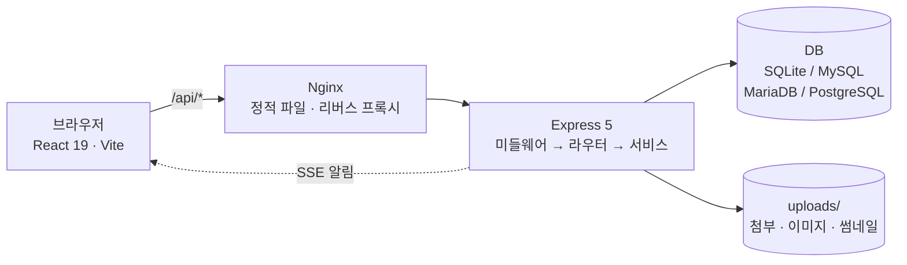
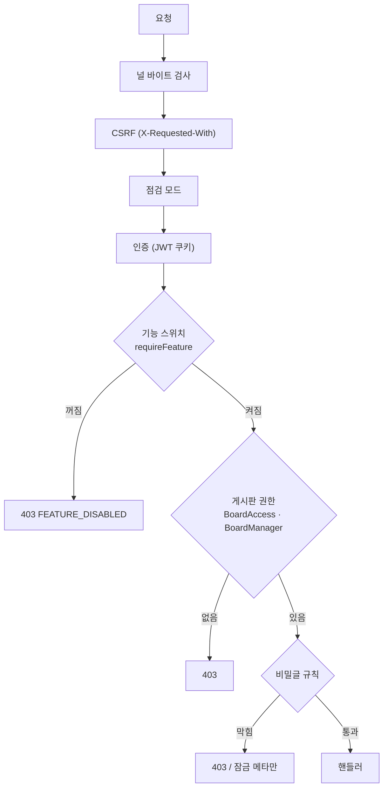
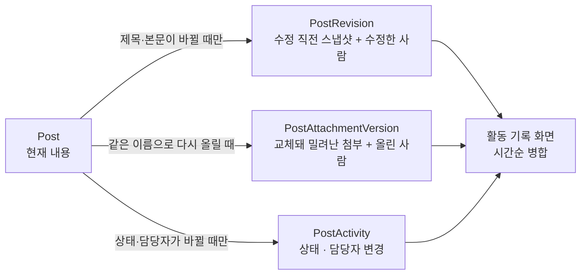
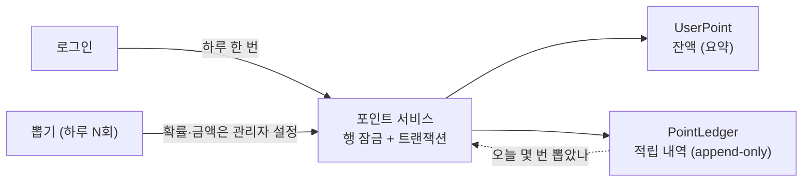

# 구조

웹 화면과 API 가 어떻게 맞물리는지, 소스가 어디에 있는지.

> 처음 띄우는 방법은 [README](../README.md) 를 보세요.

---

## 프로젝트 구조

```
tinycommunity/
├── client/                 # React + Vite
│   └── src/                # api · components · pages · hooks · store · contexts · providers
│                           # · constants · styles · types · utils · test
├── server/                 # Express + Sequelize
│   └── src/                # config · controllers · middlewares(+upload) · models · routes
│                           # · services · types · utils · validators
│       ├── __tests__/      # Jest (OS 임시 폴더의 SQLite 파일, 프로세스별)
│       └── scripts/        # DB 시드/인덱스 스크립트
├── server/.env.sample      # 환경변수 템플릿
├── docker-compose.yml      # MariaDB + App + Nginx
├── Dockerfile              # 멀티스테이지 빌드
└── nginx.conf              # 리버스 프록시
```

---

## 아키텍처



요청은 항상 같은 순서로 검사를 거칩니다. 앞 단계에서 막히면 뒤는 실행되지 않습니다.



**권한은 네 겹입니다.** 하나라도 막으면 열리지 않습니다. 화면에서 감추는 것은 편의이고,
판정은 서버가 합니다.

| 겹            | 무엇을 정하는가                                | 저장 위치                                                                            |
| ------------- | ---------------------------------------------- | ------------------------------------------------------------------------------------ |
| 기능 스위치   | 이 기능을 사이트에서 쓰는가                    | `FeatureFlag` (관리자 → 기능 설정)                                                   |
| 게시판 권한   | 이 역할이 이 게시판을 읽고/쓰고/지울 수 있는가 | `BoardAccess` (역할별)                                                               |
| 게시판 담당자 | 이 사람이 이 게시판을 관리하는가               | `BoardManager` (사용자별)                                                            |
| 글 단위 규칙  | 비밀글·개인공간·업무용·달력 여부               | `Post.isSecret` · `Board.isPersonal` · `Board.taskEnabled` · `Board.calendarEnabled` |

기본 역할은 `admin` / `manager` / `user` / `guest`입니다(앞 세 개는 삭제 불가). 관리자 페이지에서
커스텀 역할을 만들고 게시판별 권한을 부여합니다. 위키는 역할 목록으로 따로 관리합니다.
비활성 게시판은 admin/manager와 그 게시판 담당자 외에는 열리지 않습니다.

**일정은 어디에 속하느냐에 따라 판정이 갈립니다.** 전사 공유 일정(`Event.boardId` 가 비어 있음)은
역할별 `EventPermission` 을 따르고, 게시판 일정은 **그 게시판의 접근 권한**을 따릅니다 — 게시판을
볼 수 있으면 일정이 보이고, 글을 쓸 수 있으면 일정을 세우며, 남이 세운 일정은 그 게시판의
관리자만 고칩니다. 역할에 일정 수정 권한이 있어도 못 들어가는 게시판의 일정에는 닿지 못합니다.
전역 검색도 같은 규칙으로 거릅니다 — 달력에서 막은 것이 검색으로 뚫리지 않게.

**데이터 모델** (Sequelize, 49개)

| 도메인             | 모델                                                                         |
| ------------------ | ---------------------------------------------------------------------------- |
| 인증·사용자        | `User` `Role` `UserSession` `LoginHistory` `PasswordResetRequest`            |
| 게시판             | `Board` `BoardAccess` `BoardManager`                                         |
| 게시글             | `Post` `PostDraft` `PostTag` `PostRead` `PostLike` `PostScrap` `Bookmark`    |
| 게시글 이력        | `PostRevision` `PostAttachmentVersion` `PostActivity`                        |
| 댓글               | `Comment` `CommentLike` `CommentReaction`                                    |
| 소통               | `Conversation` `Message` `Subscription` `NotificationSetting` `Notification` |
| 위키·메모          | `WikiPage` `WikiRevision` `Memo`                                             |
| 이벤트             | `Event` `EventPermission`                                                    |
| 태그·신고          | `Tag` `Report`                                                               |
| 커스텀 콘텐츠·공유 | `CustomPage` `Announcement` `TempShare`                                      |
| 포인트             | `UserPoint` `PointLedger`                                                    |
| 출퇴근             | `AttendanceRecord` `AttendancePolicy` `AttendanceChecklistItem`              |
| 운영·보안          | `SiteSettings` `FeatureFlag` `IpRule` `SecurityLog` `ErrorLog` `AuditLog`    |

**글 하나에 남는 기록** — 세 테이블에 나뉘어 쌓이고, 활동 기록 화면이 시간순으로 합칩니다.
같은 내용을 두 곳에 적지 않습니다.



- `Post`·`Comment`은 soft-delete(`paranoid`)입니다. 이력 테이블은 append-only로, 한 번 적은 줄은 고치지 않습니다.
- 글을 지우면 자식(댓글·좋아요·조회기록·태그·알림)을 한 트랜잭션으로 정리하고 파일도 그 시점에 삭제합니다.
  DB 기록만 보관 기간 동안 남았다가 만료되면 영구 삭제됩니다(첨부의 이전 버전 파일도 함께).
- 첨부는 `Post.attachments`에 JSON으로 저장하고, 실제 파일은 확장자를 제거한 무작위 이름으로 `uploads/files`에 둡니다.

**포인트 적립 흐름** — 잔액(`UserPoint`)은 조회용 요약이고 실제 내역은 원장(`PointLedger`)에 있습니다.
둘은 항상 같은 트랜잭션에서 함께 갱신됩니다(테스트가 잔액 = 원장 합계를 고정합니다).



추첨은 서버에서만 이뤄지고 `crypto` 난수를 씁니다. 화면이 보낸 값은 결과에 관여하지 않습니다.
꽝도 원장에 한 줄 남깁니다. 하루 뽑기 횟수를 이 기록으로 세기 때문입니다.

**스키마 변경 방식** — `sync({alter:false})` + 부팅 시 컬럼 보강입니다. 새 컬럼은 자동으로
따라갑니다. 타입 변경은 따라가지 않는 것이 원칙이고, 예외가 둘 있습니다 — 값이 늘어나는 ENUM
컬럼은 문자열로, 파일 크기 컬럼은 `BIGINT` 로 부팅 시 넓힙니다(둘 다 실패해도 기동은 계속되고
직접 실행할 SQL 이 로그에 남습니다). 그 밖의 타입·제약 변경은 직접 `ALTER TABLE` 해야 합니다.

**인덱스는 새로 만드는 테이블에만 `sync` 가 만듭니다.** 이미 있는 테이블에는 모델에 인덱스를 적어도
생기지 않으므로(`alter:false`), 부팅 시 함께 도는 `server/src/scripts/add-indexes.ts` 목록에도 넣어야
기존 설치에 적용됩니다. 운영 DB에서 타입을 바꿔야 할 때는 별도 마이그레이션이 필요합니다.

---

## API

개발 모드에서 Swagger UI(`http://localhost:4000/api-docs`)로 전체 문서를 확인할 수 있습니다.

실시간 알림은 `GET /api/notifications/stream`(SSE)로 전달되며, 스트림이 끊기면 클라이언트가 폴링으로 자동 폴백합니다. 앱을 여러 프로세스로 띄우면 다른 프로세스가 만든 알림은 폴링 주기로만 도착합니다.

엔드포인트(전체): `/api/auth` · `/api/2fa` · `/api/boards` · `/api/board-managers` · `/api/posts` · `/api/comments` · `/api/messages` · `/api/social` · `/api/events` · `/api/memos` · `/api/wiki` · `/api/tags` · `/api/notifications` · `/api/users` · `/api/bookmarks` · `/api/drafts` · `/api/reports` · `/api/points` · `/api/attendance` · `/api/announcements` · `/api/custom-pages` · `/api/temp-share` · `/api/features` · `/api/site-settings` · `/api/admin` · `/api/uploads`

포인트 대결은 `/api/points/duels`, 퇴근 공격은 `/api/attendance/attack` 아래에 있습니다.
둘 다 기능 스위치(`tools.pointDuel`, `tools.attendanceAttack`)가 꺼져 있으면 서버가 403으로 막습니다 —
화면에서 버튼을 숨기는 것과 별개입니다.

글 상세(`GET /api/posts/:boardType/:id`)는 화면이 바로 그릴 수 있도록 태그와 보는 사람의
상태(좋아요·스크랩·관리 권한)를 함께 반환합니다. 따로 조회하면 글 하나를 여는 데 왕복이 넷이 됩니다.
